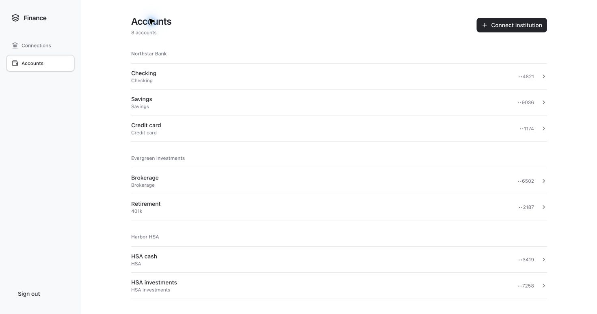

# Personal Finance MCP

**Your finances, connected to your assistant.**

Accounts, investments, and history across institutions. 
Private. Read-only. Built for personal use.

[Open workspace](https://finance-mcp.benepass-mcp-cloudflare.workers.dev/connections) · [MCP endpoint](https://finance-mcp.benepass-mcp-cloudflare.workers.dev/mcp) · [Setup guide](SETUP.md)

---

## A clear view of your finances

Personal Finance MCP gives a compatible AI assistant one place to read your accounts, balances, holdings, and saved history. Manage connections and account preferences in a compact private workspace built with React and shadcn/ui.

Actual interface, demonstration data. The live workspace requires owner sign-in.

## What you can ask

> “Break down my net worth by institution and account.”
>
> “How much is in my HSA cash and investments?”
>
> “How have my saved balances changed over time?”
>
> “Show my holdings and recent investment activity.”

| Capability | What it gives you |
| --- | --- |
| **Accounts & balances** | Checking, savings, credit, brokerage, retirement, and HSA accounts returned by connected providers. |
| **Investments** | Holdings and supported investment activity, with brokerage cash included in account balances. |
| **Net worth** | Account-level totals separated by currency, with missing and stale data clearly flagged. |
| **History** | Daily balance observations, banking transactions, and supported investment activity. |
| **Account preferences** | Custom names and separate choices for inclusion in net worth and spending analysis. |

Holdings explain an investment balance; they are never added to that balance again. Benepass and UMB HSA cash and investments appear separately. Missing balances stay unknown, and account suffixes appear only when verified numbers are available.

## Connect your institutions

| Integration | Coverage |
| --- | --- |
| [**Plaid**](https://plaid.com/docs/) | Supported banks, credit cards, brokerages, and retirement accounts. Available data depends on the institution, login portal, and enabled products. |
| **UMB HSA** | Direct HSA cash, investment balances, and available cash transaction history. Sign in with your UMB credentials and complete verification when required. |
| **Benepass** | Direct HSA cash, investment balances, and holdings. Transaction history is not currently normalized. |

Choose **Connect institution** in the workspace. Plaid is the primary flow; direct integrations live under **Other institutions**. Connection management, login codes, and account settings stay in the browser.

## History that stays useful

Refreshes start at **midnight Pacific**, with daylight saving time handled automatically. Verified Plaid webhooks also schedule updates, and you can refresh an institution from its connection panel.

Balance history begins with the first successful observation. Transaction and investment history can backfill what the provider allows; the server never invents earlier daily balances. Every retrieved balance carries a timestamp. A recent retrieval does not guarantee a live market valuation.

Disconnecting removes accounts from personal totals and stops synchronization while keeping saved history available.

## Private, read-only access

- **Owner-only sign-in** through Cloudflare Access, with OAuth for MCP clients.
- **Read-only finance tools**: no transfers, payments, or trades.
- **Encrypted stored Plaid credentials**, with secrets kept out of source control and assistant messages.
- **Explicit data quality**: unavailable connections, missing values, and observations older than 36 hours are flagged.

Use the [MCP endpoint](https://finance-mcp.benepass-mcp-cloudflare.workers.dev/mcp) in a compatible remote MCP client. It supports Streamable HTTP and OAuth. Client support must be verified during setup.

## Small stack, one deployment

| Layer | Built with |
| --- | --- |
| Runtime & routing | [Cloudflare Workers](https://developers.cloudflare.com/workers/) + [Hono](https://hono.dev/) |
| Interface | [React](https://react.dev/) + [shadcn/ui](https://ui.shadcn.com/) + [Tailwind CSS](https://tailwindcss.com/) |
| Financial history | SQLite-backed [Durable Objects](https://developers.cloudflare.com/durable-objects/) + [Drizzle](https://orm.drizzle.team/) |
| Authentication | Cloudflare Access + OAuth + Workers KV |
| Financial data | Official Plaid SDK + direct Benepass adapter |

One Worker serves both the interface and MCP endpoint. No external database is required. The deployment is designed to stay within Cloudflare Free plan limits; provider access and quotas are separate. Check [Plaid's current plans](https://plaid.com/pricing/) before connecting production institutions.

Development, credentials, deployment, and detailed history behavior are covered in the [setup guide](SETUP.md).

---

Built by [Brian Lee](https://github.com/brian7989) · [MIT license](LICENSE)

